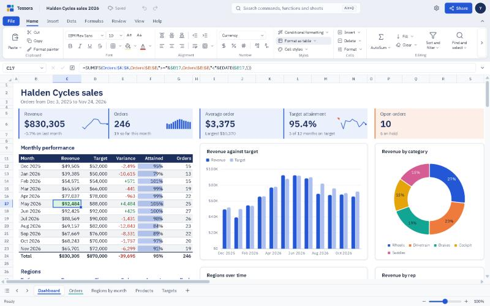
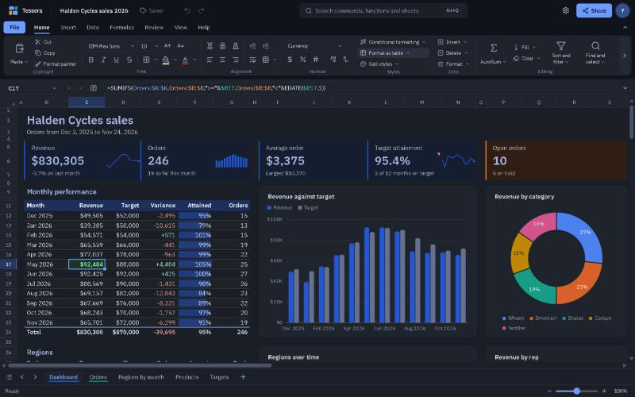
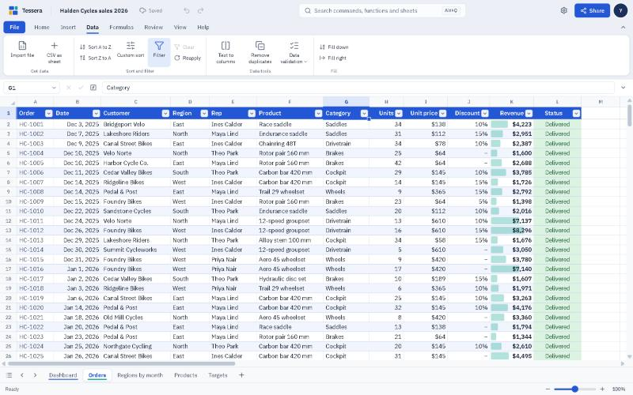

# Excel-Lens

Excel-Lens is a spreadsheet that runs entirely in the browser. It has a ribbon, a formula bar, a fast canvas grid, its own formula engine, live charts, and Excel, CSV and PDF support. There is no server, no account and no API key, and it works offline after the first load.

**Live app: https://sugamghimire-1.github.io/Excel-Lens/**



| Dark mode | Tables, filters and conditional formats |
| --- | --- |
|  |  |

The first run opens a sample sales workbook: a dashboard with summary tiles and four charts, a 246-row order table, a region heat map, a product list and targets, all driven by formulas.

## Quick start

Requires Node.js 22.12 or newer.

```bash
npm install
npm run dev        # http://localhost:5173
```

| Command | What it does |
| --- | --- |
| `npm run dev` | Start the development server |
| `npm run build` | Type-check and build to `dist/` |
| `npm run preview` | Serve the production build |
| `npm run test` | Run the unit tests once |
| `npm run test:watch` | Run tests on change |
| `npm run typecheck` | Type-check only |

`dist/` is a static site. Host it on any file server, including a subfolder, because asset paths are relative.

### Hosting on GitHub Pages

`.github/workflows/deploy.yml` runs the tests, builds the app and publishes `dist/` on every push to `main`. In the repository settings, set **Pages > Build and deployment > Source** to **GitHub Actions**. Pull requests are tested but not deployed.

## Features

**Grid**
- 500,000 rows by 1,024 columns per sheet, drawn on canvas. Only visible cells are painted.
- Cell, range, multi-range, row, column and whole-sheet selection
- Drag to select, move, fill and resize. Double-click to AutoFit or fill down.
- Frozen rows and columns, hidden rows and columns, merged cells, text overflow and wrapping
- In-cell and formula-bar editing, with Enter, Tab, arrow, Escape, F2 and F4 behaviour that spreadsheet users expect
- Zoom from 25% to 400%, dark mode, touch selection on tablets

**Editing**
- Undo and redo for every document change, with a history panel
- Cut, copy and paste with other applications (HTML and tab-separated text), and paste special
- Autofill for numbers, dates, months, weekdays, quarters and numbered text
- Insert and delete cells, rows and columns. References update everywhere.
- Find and replace with regular expressions, across a selection, sheet or workbook
- Notes, links, checkboxes, defined names and sheet protection

**Formatting**
- Fonts, sizes, colors, borders, alignment, wrapping, indents and number formats (full format codes)
- Conditional formatting: comparisons, text, duplicates, top and bottom, averages, blanks, errors, formulas, data bars, color scales and icon sets
- Cell styles, table styles with banding, and five workbook themes
- Sparklines: line, column and win/loss

**Formulas**
- More than 200 functions: math, statistical, logical, lookup, text, date, financial, information and array
- Relative, absolute and mixed references, whole rows and columns, cross-sheet references and names
- Dynamic arrays that spill, including `FILTER`, `SORT`, `UNIQUE`, `SEQUENCE` and the `#` operator
- Dependency-tracked recalculation, cycle detection, and automatic or manual mode
- Autocomplete, argument hints, colored references, point-and-click references, and precedent and dependent tracing
- Errors: `#DIV/0!` `#VALUE!` `#REF!` `#NAME?` `#N/A` `#NUM!` `#NULL!` `#SPILL!` `#CALC!` `#CIRC!`

**Data**
- Sorting by several levels, by value or color
- AutoFilter by value, condition or top items
- Data validation: lists, numbers, dates, text length, custom formulas, required cells, hints and custom errors
- Remove duplicates, text to columns, circle invalid data

**Charts**
- Column, bar, line, area, pie, doughnut and scatter
- Editable type, range, series direction, title, axis titles, legend, labels, gridlines and colors
- Charts update as their data changes, and can be downloaded as images

**Files**
- Import and export `.xlsx` with formulas, formatting, merges, notes, links, validation, conditional formats, filters, names, frozen panes and charts
- Import and export `.csv`
- Export a selection, sheet or workbook as PDF with searchable text
- Autosave to IndexedDB, recent files, save a copy, and `.xlens` backups
- Share links that carry the compressed workbook in the URL fragment, so nothing is uploaded

**Accessibility**
- Keyboard access to every command, plus a command palette (Alt+Q)
- ARIA roles and labels, visible focus, reduced-motion support
- Live announcements of the active cell, because the grid itself is a canvas

## Tech stack

| Area | Choice |
| --- | --- |
| UI | React 19, TypeScript, Tailwind CSS 3, Lucide icons |
| State | Zustand |
| Grid | Custom dual-canvas renderer |
| Formulas | Custom tokenizer, Pratt parser, evaluator and dependency graph |
| Charts | Apache ECharts (tree-shaken, loaded on demand) |
| Excel files | ExcelJS and JSZip, plus a hand-written DrawingML chart reader and writer |
| PDF | jsPDF |
| Build and tests | Vite 8, Vitest 5 |
| Type | IBM Plex Sans, self-hosted |

## Architecture

```
 UI (features, components)
   |  calls                      subscribes
   v                                 ^
 actions, selection, editing  ->  Zustand stores
   |  build Op[]                     |
   v                                 |
 engine/commands  ->  engine/ops.applyOps  ->  CalcEngine
```

1. **Commands** in `engine/commands` are pure functions. They read the workbook and return a list of operations.
2. **`applyOps`** applies operations and returns their inverse. Undo, redo and the history panel are built on that alone.
3. **`CalcEngine`** marks the transitive dependents of changed cells and evaluates them in topological order, so deep chains never overflow the stack.
4. **`GridController`** owns the canvases and pointer input, and draws in animation frames outside React.
5. **`StorageProvider`** is the only place that knows where workbooks live.

### Preparing for real-time collaboration

- Every change is a serialisable `Op` with a known inverse (`src/types/index.ts`).
- `onTransaction` in `state/workbookStore.ts` publishes each committed transaction. A transport can broadcast `tx.ops` and apply remote ones with `dispatch(label, ops, { silent: true })`.
- Replace `IndexedDbProvider` in `state/storage.ts` with an HTTP implementation of `StorageProvider` to add cloud files.
- Conflict resolution (operational transform or CRDT) is not included. It belongs between the transport and `dispatch`.

## Folder structure

```
spreadsheet-app/
├── docs/                 Screenshots
├── public/               Favicon and web manifest
├── src/
│   ├── main.tsx          Entry point and service-worker registration
│   ├── App.tsx           Window layout, boot, global shortcuts, file drop
│   ├── components/       Reusable UI: buttons, menus, dialogs, popovers, fields
│   ├── features/
│   │   ├── appBar/       Title bar, save state, share
│   │   ├── backstage/    File screen, templates, sample workbook
│   │   ├── charts/       ECharts options, live charts, chart layer
│   │   ├── dialogs/      All dialogs
│   │   ├── formulaBar/   Name box and formula input
│   │   ├── grid/         Renderer, controller, editor, keyboard, overlays
│   │   ├── io/           xlsx, csv, pdf and share links
│   │   ├── menus/        Context menus and the floating toolbar
│   │   ├── palette/      Command palette
│   │   ├── panels/       Chart, rules, notes and history panels
│   │   ├── ribbon/       Ribbon tabs and galleries
│   │   ├── sheetTabs/    Sheet tab bar
│   │   └── statusBar/    Selection statistics and zoom
│   ├── engine/           Document model, operations, commands, formats, themes
│   ├── formulas/         Tokenizer, parser, evaluator, calc engine, functions
│   ├── state/            Stores, actions, selection, editing, persistence
│   ├── styles/           Design tokens and global styles
│   ├── types/            Workbook, sheet, cell, style, chart and operation types
│   └── utils/
└── tests/                Formula, calculation, engine and file-format tests
```

## Performance

Measured on a developer laptop in Chromium, with 100,000 rows, 300,000 filled cells and 100,000 formulas:

| Action | Time |
| --- | --- |
| Load and calculate everything | about 1 s |
| Edit one cell and recalculate its dependents | about 26 ms |
| Paint a 1900 x 900 viewport (median) | about 5 ms |

## Known limitations

- Formatting applies to whole cells. Rich text inside one cell is flattened on import.
- Not included: pivot tables, macros, images and shapes, iterative calculation, `LAMBDA`, structured table references (`Table1[Column]`) and external links.
- `.xlsx`: table styling is written as plain formatting, and sparklines and workbook themes are not exported. Passwords and the old `.xls` format are not supported.
- Charts draw one value axis. Combination, stock, radar and 3D charts are not supported and are skipped on import.
- Sheet protection prevents accidental edits. It is not a security feature.
- Locale is en-US for dates, separators and function names.
- PDF pages are images with a searchable text layer. The layer covers Latin-1 characters only.
- Share links are limited to workbooks that compress to about 60 KB.

## Roadmap

- Live co-editing over the existing operation log, with presence and conflict resolution
- Pivot tables and slicers
- Structured references and a totals-row builder for tables
- Calculation in a Web Worker for very large models
- Rich text inside cells, images and shapes
- Combination charts, trendlines and error bars
- More locales and right-to-left layout

## License

[MIT](LICENSE)
